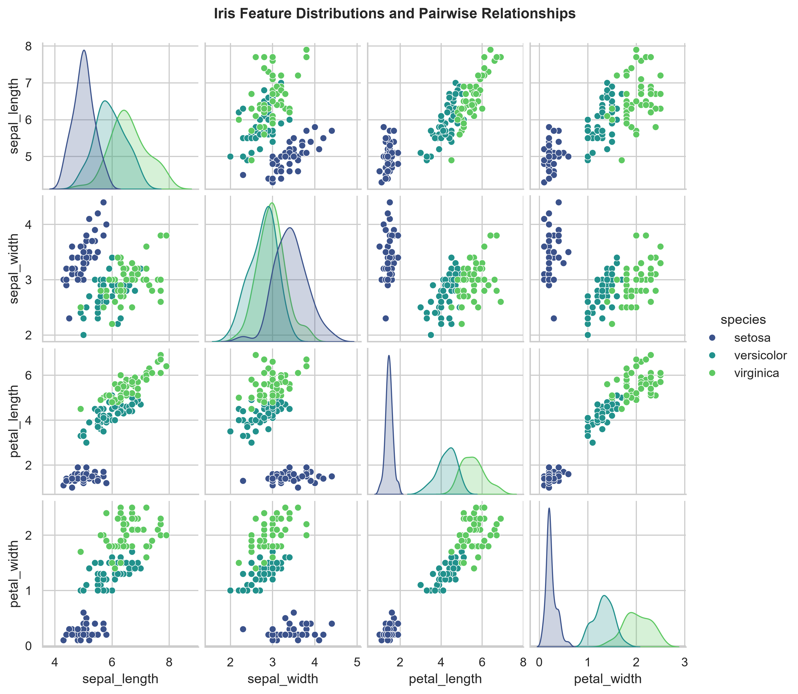
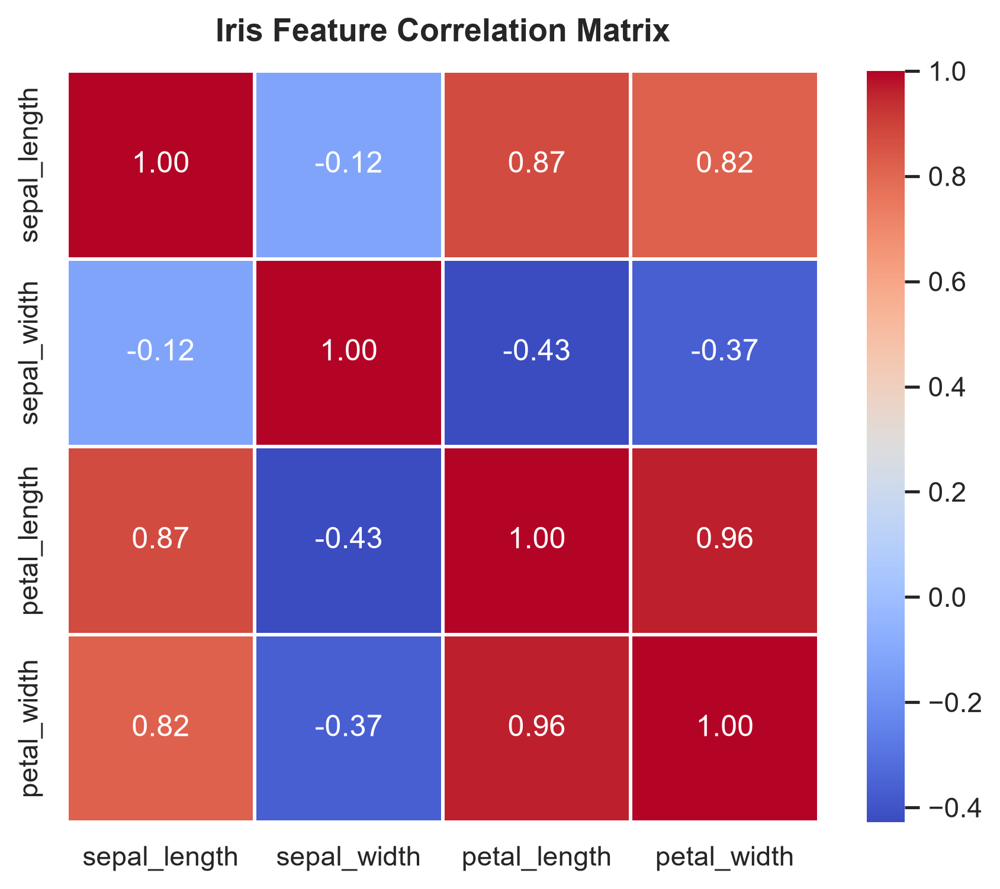
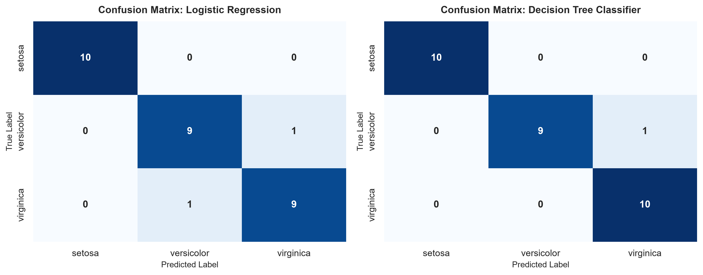
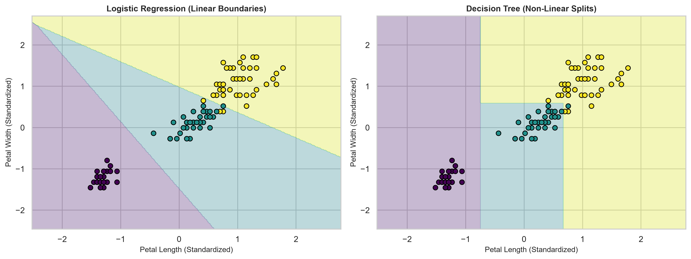

# Task 1: Multi-Class Benchmark Classification Pipeline (Iris Dataset)

**Curriculum Reference:** DT-2026-NKPSG  
**Focus:** Exploratory Data Analysis, Feature Scaling, Multi-Class Model Benchmarking  

---

## 1. Executive Summary

This task implements an end-to-end multi-class classification benchmark on the classic Iris dataset. The pipeline demonstrates data ingestion, exploratory distributions, feature scaling, model training, and comparative evaluation.

### Benchmark Results (Holdout Test Set)

| Model | Accuracy | Precision (Weighted) | Recall (Weighted) | F1-Score (Weighted) |
| :--- | :---: | :---: | :---: | :---: |
| **Logistic Regression** | 93.33% | 93.33% | 93.33% | 93.33% |
| **Decision Tree Classifier** | **96.67%** | **96.97%** | **96.67%** | **96.66%** |

---

## 2. Visualizations and Artifacts

### 2.1 Feature Distributions & Bivariate Relationships
Pairplot demonstrating class separability across physical measurements (*setosa* shows clean linear separability from *versicolor* and *virginica*):



### 2.2 Feature Correlation Matrix
Heatmap showing strong positive correlations between petal length and petal width ($r = 0.96$):



### 2.3 Confusion Matrices
Side-by-side confusion matrix comparisons across the 30-sample holdout test set:



### 2.4 Decision Boundary Comparison
2D decision boundaries plotted using standardized petal length and petal width:



---

## 3. Directory Structure

```text
01-iris-classification/
├── data/
│   └── iris.csv                                 # Benchmark dataset
├── notebooks/
│   └── iris_classification_pipeline.ipynb       # Pre-rendered Jupyter Notebook
├── src/
│   └── pipeline.py                              # Modular Python pipeline script
├── assets/                                      # Saved high-resolution figures
│   ├── iris_pairplot.png
│   ├── feature_correlation.png
│   ├── confusion_matrices.png
│   └── decision_boundaries.png
└── README.md                                    # Documentation and metrics report
```

---

## 4. How to Run

### Run Standalone Script
```bash
python 01-iris-classification/src/pipeline.py
```

### View Jupyter Notebook
Open `01-iris-classification/notebooks/iris_classification_pipeline.ipynb` in an editor or Jupyter to inspect the code, formulas, and pre-computed visual outputs.
