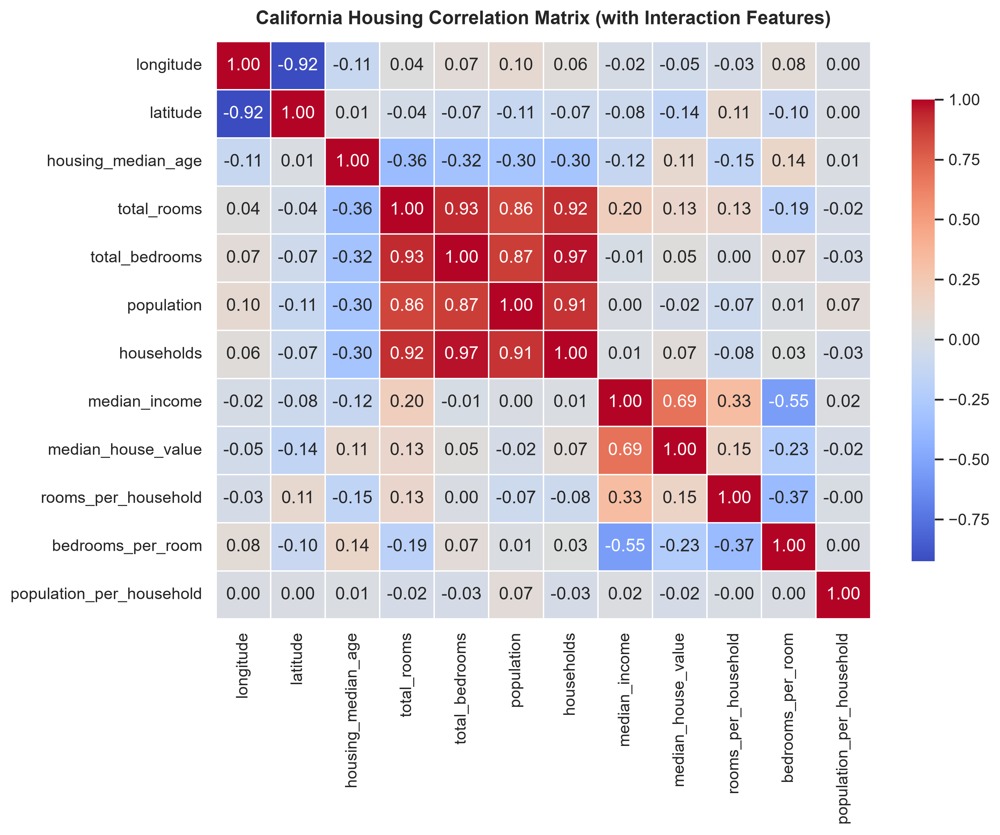
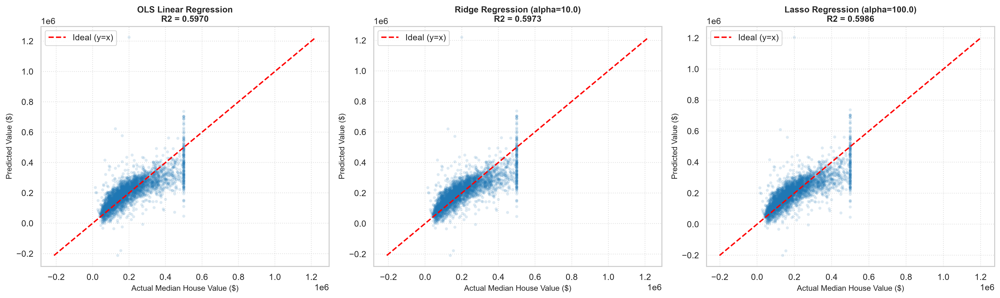
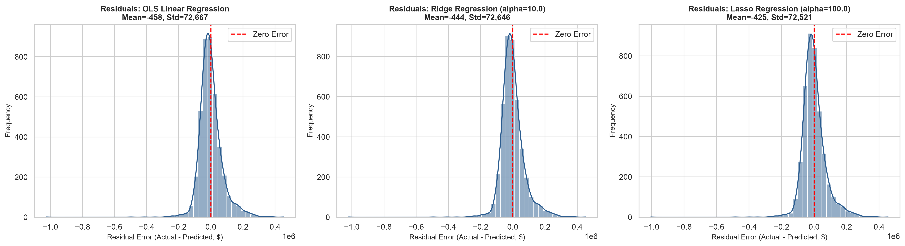
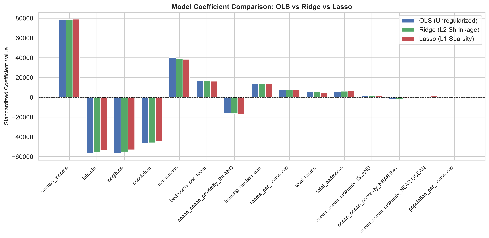

# Task 2: Real Estate Housing Price Prediction (Ridge & Lasso Regression)

**Curriculum Reference:** DT-2026-NKPSG  
**Focus:** Continuous Regression Modeling, Feature Engineering, Regularization & Residual Analysis  

---

## 1. Executive Summary

This task implements continuous regression modeling on the California Housing dataset to predict median house values. The pipeline features median imputation for missing data, interaction feature construction, one-hot categorical encoding, and 5-fold cross-validated hyperparameter tuning across regularized models.

### Benchmark Results (Holdout Test Set)

| Model | RMSE ($) | MAE ($) | R² Score | Optimal Hyperparameter |
| :--- | :---: | :---: | :---: | :--- |
| **OLS Linear Regression** | $72,668.54 | $50,888.66 | 0.5970 | N/A (Unregularized) |
| **Ridge Regression (L2)** | $72,647.55 | $50,885.56 | 0.5973 | $\alpha = 10.0$ |
| **Lasso Regression (L1)** | **$72,522.08** | **$50,832.25** | **0.5986** | $\alpha = 100.0$ |

---

## 2. Visualizations and Artifacts

### 2.1 Feature Correlation Heatmap
Correlation matrix including newly constructed interaction ratios (`rooms_per_household`, `bedrooms_per_room`, `population_per_household`):



### 2.2 Predicted vs Actual Values
Scatter plot of predictions against true median house values with the $y = x$ reference line:



### 2.3 Residual Error Distributions
Distribution of residual errors ($y - \hat{y}$) across all three regression models:



### 2.4 Model Coefficient Comparison (Shrinkage Analysis)
Comparison of learned feature coefficients showing L2 shrinkage (Ridge) and L1 sparsity (Lasso):



---

## 3. Directory Structure

```text
02-housing-price-prediction/
├── data/
│   └── housing.csv                              # California Housing dataset
├── notebooks/
│   └── housing_price_regression.ipynb           # Pre-rendered Jupyter Notebook
├── src/
│   └── pipeline.py                              # Modular Python pipeline script
├── assets/                                      # Saved high-resolution figures
│   ├── correlation_matrix.png
│   ├── predicted_vs_actual.png
│   ├── residual_distributions.png
│   └── coefficient_comparison.png
└── README.md                                    # Documentation and metrics report
```

---

## 4. How to Run

### Run Standalone Script
```bash
python 02-housing-price-prediction/src/pipeline.py
```

### View Jupyter Notebook
Open `02-housing-price-prediction/notebooks/housing_price_regression.ipynb` in an editor or Jupyter interface to view the step-by-step markdown, formulas, and pre-computed visual outputs.
