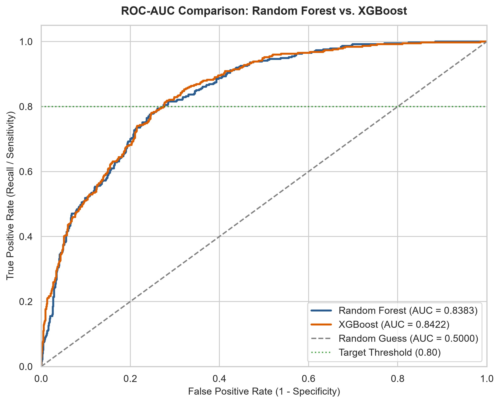
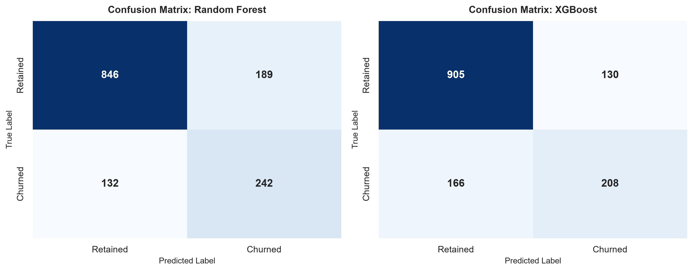
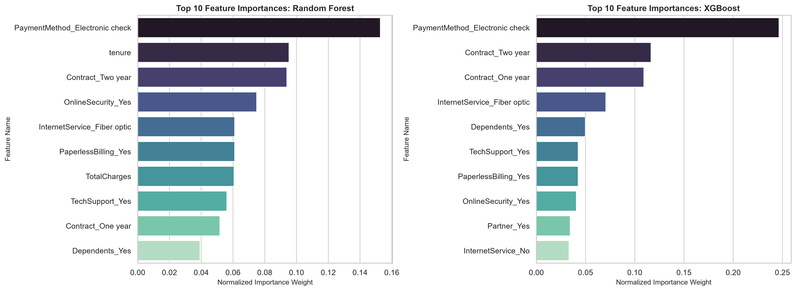

# Task 3: Predictive Customer Churn Classifier (Random Forest & XGBoost)

**Curriculum Reference:** DT-2026-NKPSG  
**Focus:** Severe Class Imbalance Handling, SMOTE Resampling, Ensemble Tree Modeling & ROC-AUC Optimization  

---

## 1. Executive Summary

This task implements an ensemble machine learning classification pipeline to predict customer churn using telecom subscription records. The dataset presents significant class imbalance (~73.5% retained vs. ~26.5% churned). The pipeline addresses this through median imputation, one-hot categorical encoding, and Synthetic Minority Over-sampling Technique (SMOTE) on the training set.

### Benchmark Results (Holdout Test Set)

| Model | Accuracy | Precision | Recall | F1-Score | ROC-AUC | Target Met (>0.80) |
| :--- | :---: | :---: | :---: | :---: | :---: | :---: |
| **Random Forest** | 77.22% | 56.15% | **64.71%** | **60.12%** | **0.8383** | Yes |
| **XGBoost** | **78.99%** | **61.54%** | 55.61% | 58.43% | **0.8422** | Yes |

---

## 2. Visualizations and Artifacts

### 2.1 ROC-AUC Discrimination Curves
Comparison of Random Forest and XGBoost discrimination curves against the diagonal random baseline and the 0.80 target threshold:



### 2.2 Confusion Matrices
Side-by-side confusion matrix heatmaps showing classification distributions on the holdout test set:



### 2.3 Top 10 Influential Feature Importances
Normalized Gini and gradient-gain importance weights identifying key drivers of customer attrition:



---

## 3. Directory Structure

```text
03-customer-churn-classifier/
├── data/
│   └── Telco-Customer-Churn.csv                 # Telco subscription records
├── notebooks/
│   └── customer_churn_prediction.ipynb          # Pre-rendered Jupyter Notebook
├── src/
│   └── pipeline.py                              # Modular Python pipeline script
├── assets/                                      # Saved high-resolution figures
│   ├── roc_auc_curves.png
│   ├── confusion_matrices.png
│   └── feature_importance.png
└── README.md                                    # Documentation and metrics report
```

---

## 4. How to Run

### Run Standalone Script
```bash
python 03-customer-churn-classifier/src/pipeline.py
```

### View Jupyter Notebook
Open `03-customer-churn-classifier/notebooks/customer_churn_prediction.ipynb` in an editor or Jupyter interface to inspect the code, formulas, and pre-computed visual outputs.
