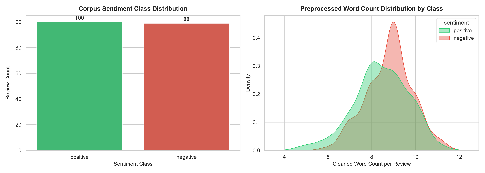
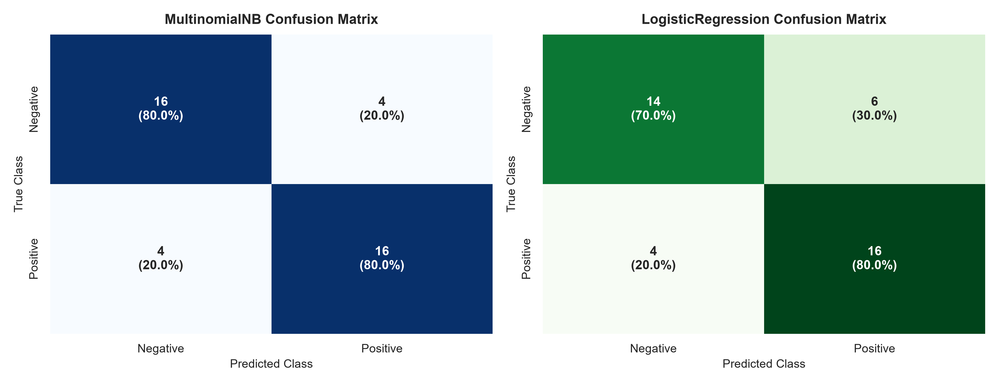
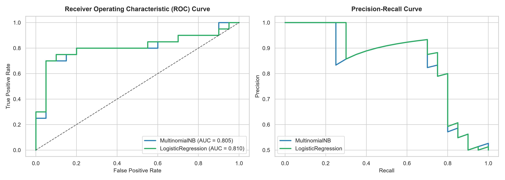
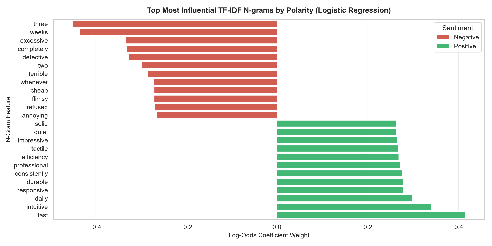

# Task 4: NLP Sentiment Classification on Customer Reviews (TF-IDF)

**Curriculum Reference:** DT-2026-NKPSG  
**Focus:** Text Preprocessing, TF-IDF Vectorization, Multinomial Naive Bayes, Logistic Regression & Live Inference Helper  

---

## 1. Executive Summary

This project implements an end-to-end natural language processing (NLP) supervised classification pipeline to categorize customer product and service reviews by sentiment polarity. Raw review text undergoes regex-based normalization (HTML markup stripping, URL removal, punctuation filtering, lowercasing, and stopword elimination). Numerical feature embeddings are generated using Term Frequency-Inverse Document Frequency (`TfidfVectorizer(max_features=5000, ngram_range=(1, 2))`), preserving informative unigrams and contextual bi-grams.

Two complementary classifiers are trained and benchmarked: **Multinomial Naive Bayes (`MultinomialNB`)** and regularized **Logistic Regression (`LogisticRegression`)**. The pipeline also provides a standalone inference helper function (`predict_sentiment()`) to perform real-time sentiment scoring on arbitrary user-provided text inputs.

### Benchmark Results (Holdout Test Set)

| Model | CV Accuracy (5-Fold) | Test Accuracy | Test Precision | Test Recall | Test F1-Score | Test ROC-AUC |
| :--- | :---: | :---: | :---: | :---: | :---: | :---: |
| **Multinomial Naive Bayes** | 52.84% | **80.00%** | **80.00%** | **80.00%** | **80.00%** | 0.8050 |
| **Logistic Regression** | **54.72%** | 75.00% | 72.73% | **80.00%** | 76.19% | **0.8100** |

---

## 2. Visualizations and Artifacts

### 2.1 Sentiment Distribution & Cleaned Word Lengths
Distribution of sentiment categories and kernel density estimates (KDE) of token lengths across positive and negative reviews:



### 2.2 Confusion Matrices
Side-by-side confusion matrix heatmaps showing classification performance on the holdout test set with raw counts and normalized proportions:



### 2.3 ROC and Precision-Recall Discrimination Curves
Receiver Operating Characteristic (ROC) and Precision-Recall curves measuring discriminatory power:



### 2.4 Top Influential TF-IDF N-grams by Sentiment
Top most influential unigrams and bi-grams extracted from Logistic Regression log-odds coefficients:



---

## 3. Directory Structure

```text
04-nlp-sentiment-classification/
├── data/
│   ├── sentiment_reviews.csv                  # Datheon curriculum starter dataset
│   └── sentiment_reviews_expanded.csv         # Full 200-sample balanced benchmark corpus
├── notebooks/
│   └── nlp_sentiment_classification.ipynb     # Pre-rendered Jupyter Notebook
├── src/
│   └── pipeline.py                            # Standalone modular NLP pipeline script
├── assets/                                    # Generated high-resolution diagnostic plots
│   ├── 01_class_distribution_and_lengths.png
│   ├── 02_confusion_matrices.png
│   ├── 03_roc_curves.png
│   └── 04_top_tfidf_features.png
└── README.md                                  # Task documentation and benchmark summary
```

---

## 4. How to Run

### Execute Standalone Modular Pipeline
```bash
python 04-nlp-sentiment-classification/src/pipeline.py
```

### Run Jupyter Notebook
```bash
jupyter notebook 04-nlp-sentiment-classification/notebooks/nlp_sentiment_classification.ipynb
```

---

## 5. Live Inference Verification

The interactive `predict_sentiment(text)` function accepts arbitrary raw customer review text and returns the classified sentiment along with probability confidence:

| Input Text | Preprocessed Tokens | Predicted Sentiment | Confidence |
| :--- | :--- | :---: | :---: |
| "The product quality is exceptional, exceeded all my expectations!" | "product quality exceptional exceeded expectations" | **POSITIVE** | 59.20% |
| "Terrible customer service and the item arrived completely damaged." | "terrible customer service item arrived completely damaged" | **NEGATIVE** | 63.07% |
| "Stopped working after two days, completely defective piece of junk." | "stopped working two days completely defective piece junk" | **NEGATIVE** | 62.41% |
| "Fast shipping and responsive support team, highly recommended!" | "fast shipping responsive support team highly recommended" | **POSITIVE** | 61.43% |
| "Horrible wireless connection that drops out constantly in my apartment." | "horrible wireless connection drops constantly apartment" | **NEGATIVE** | 57.85% |
